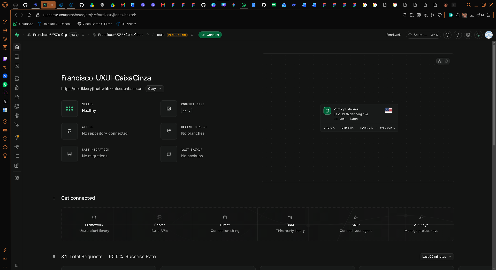
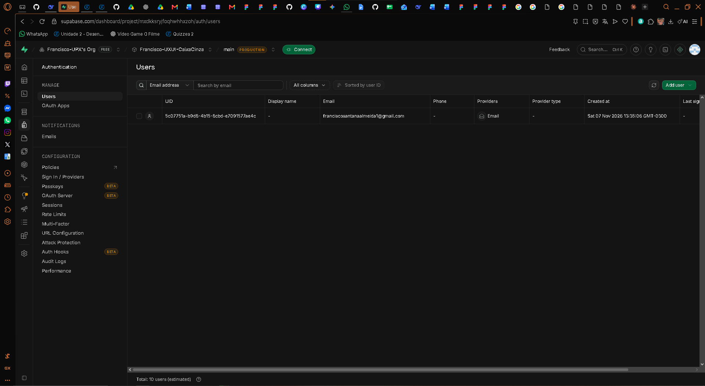
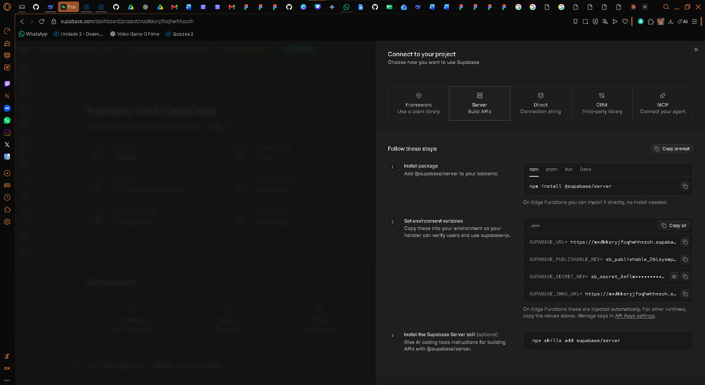
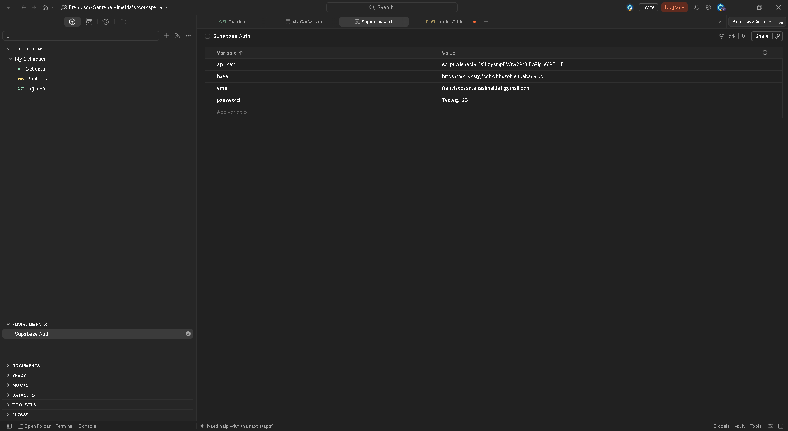
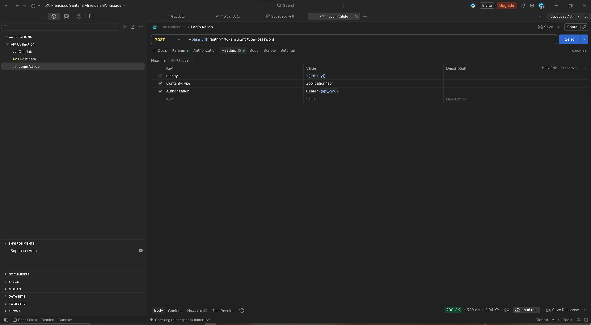
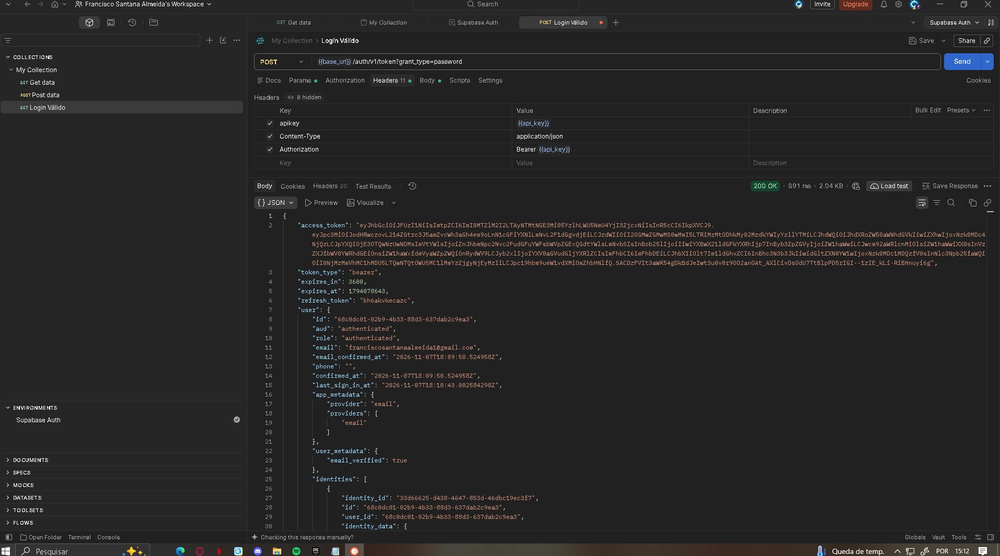
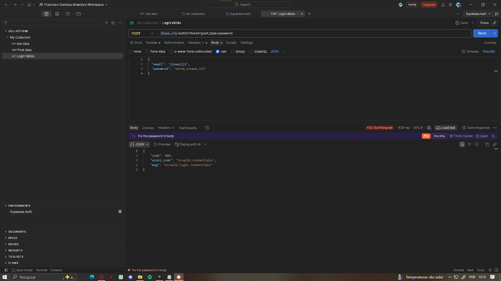
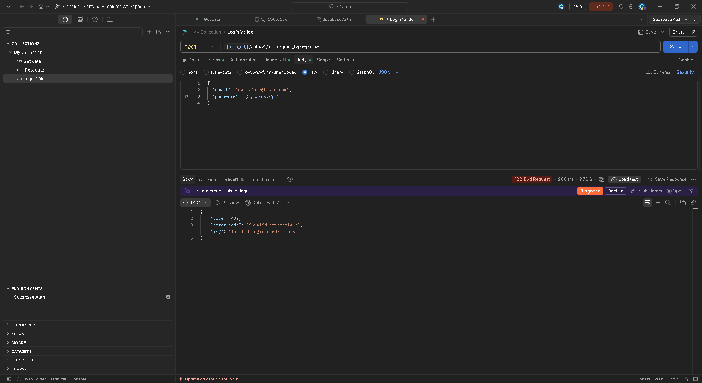
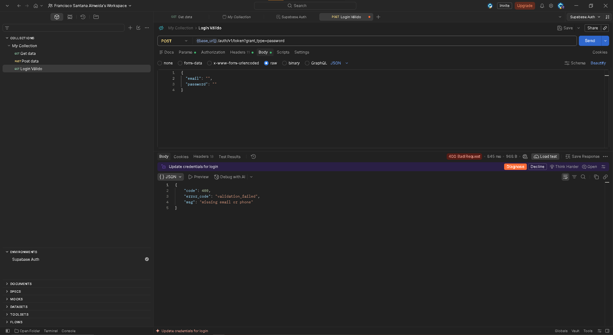
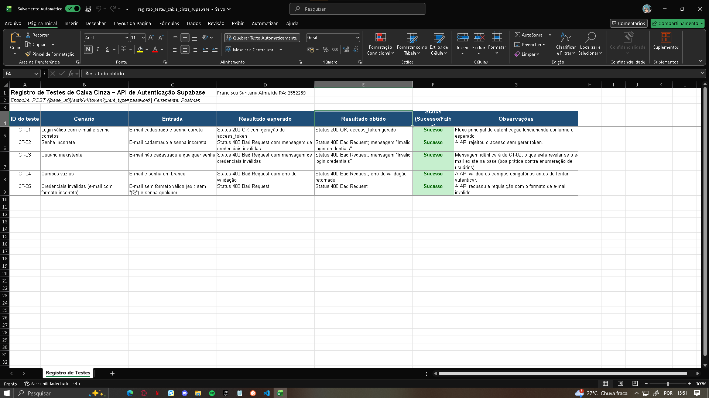

# TESTE CAIXA CINZA COM SUPABASE E POSTMAN

| | |
|---|---|
| **Projeto** | TESTE CAIXA CINZA COM SUPABASE E POSTMAN |
| **Aluno** | Francisco Santana Almeida |
| **RA** | 252259 |
| **Curso** | Análise e Desenvolvimento de Sistemas |
| **Disciplina** | UX/UI e Testes de Software |
| **Professor** | Daniel Domingos Akira de Sá Pimentel Ohata |
| **Semestre** | 2026.2 |

---

# Introdução

Este trabalho apresenta a aplicação de **testes de caixa cinza** em uma API de autenticação construída com o **Supabase**, utilizando o **Postman** como ferramenta de execução das requisições. No teste de caixa cinza, o testador conhece parcialmente o funcionamento interno do sistema (como o endpoint, o formato das requisições e o comportamento esperado das respostas), mas valida o resultado a partir do comportamento externo da API.

# Objetivo da Atividade

Validar o comportamento do endpoint de autenticação por e-mail e senha do Supabase em diferentes cenários, verificando se a API:

- autentica corretamente um usuário válido, retornando o `access_token`;
- rejeita tentativas de acesso com senha incorreta, usuário inexistente, campos vazios e e-mail em formato inválido;
- retorna os códigos de status HTTP e as mensagens esperados em cada situação.

# Configuração do Supabase

Foi criado um projeto no Supabase e configurada a autenticação por **e-mail e senha** (Email Auth). Em seguida, foi cadastrado um **usuário de teste**, utilizado nos cenários de login. As credenciais da API (URL do projeto e chave `anon`) foram obtidas no painel do projeto para uso no Postman.



*Figura 1: Painel do projeto criado no Supabase.*



*Figura 2: Usuário de teste criado na aba de autenticação.*



*Figura 3: Credenciais da API (URL do projeto e chave `anon`).*

# Configuração do Postman

No Postman foi criado um **Workspace** específico para a atividade e um **Environment** com as seguintes variáveis:

| Variável | Descrição |
|---|---|
| `base_url` | URL base do projeto Supabase |
| `api_key` | Chave pública (`anon`) do projeto |
| `email` | E-mail do usuário de teste |
| `password` | Senha do usuário de teste |

O uso de variáveis de ambiente evita repetir valores nas requisições e facilita a troca de dados entre os cenários.



*Figura 4: Environment do Postman com as variáveis configuradas.*

# Configuração das Requisições

A requisição de login utiliza o seguinte endpoint:

- **Método:** `POST`
- **URL:** `{{base_url}}/auth/v1/token?grant_type=password`

**Headers:**

| Header | Valor |
|---|---|
| `apikey` | `{{api_key}}` |
| `Content-Type` | `application/json` |
| `Authorization` | `Bearer {{api_key}}` |

**Body (raw / JSON):**

```json
{
  "email": "{{email}}",
  "password": "{{password}}"
}
```



*Figura 5: Requisição de login configurada no Postman.*

# Execução dos Testes

Foram executados cinco cenários sobre o mesmo endpoint, alterando apenas os dados enviados no corpo da requisição.

| ID | Cenário | Resultado esperado | Resultado obtido | Status |
|---|---|---|---|---|
| CT-01 | Login válido | 200 OK com `access_token` | 200 OK | Sucesso |
| CT-02 | Senha incorreta | 400 Bad Request | 400 Bad Request | Sucesso |
| CT-03 | Usuário inexistente | 400 Bad Request | 400 Bad Request | Sucesso |
| CT-04 | Campos vazios | 400 Bad Request | 400 Bad Request | Sucesso |
| CT-05 | Credenciais inválidas (e-mail com formato incorreto) | 400 Bad Request | 400 Bad Request | Sucesso |



*Figura 6: Login válido retornando 200 OK e o `access_token`.*



*Figura 7: Senha incorreta retornando 400 com a mensagem "Invalid login credentials".*



*Figura 8: Usuário inexistente retornando 400 com a mensagem "Invalid login credentials".*



*Figura 9: Campos vazios retornando 400 com erro de validação.*

# Registro dos Testes

Para garantir a rastreabilidade, todos os testes foram registrados em uma planilha contendo ID do teste, cenário, entrada, resultado esperado, resultado obtido, status e observações. O arquivo está disponível na pasta `/planilha/` deste repositório.



*Figura 10: Planilha de registro dos testes.*

# Resultados Obtidos

Todos os cinco cenários tiveram o comportamento esperado:

- **Login válido:** a API retornou `200 OK` e gerou o `access_token`.
- **Senha incorreta e usuário inexistente:** a API retornou `400 Bad Request` com a mesma mensagem ("Invalid login credentials"), o que evita revelar se o e-mail existe na base.
- **Campos vazios:** a API retornou `400 Bad Request` com erro de validação.
- **E-mail com formato inválido:** a API retornou `400 Bad Request`.

Portanto, os 5 testes foram classificados como **Sucesso**, pois a API se comportou conforme o esperado, inclusive nos cenários de erro.

# Conclusão

A atividade permitiu validar com sucesso o fluxo de autenticação da API do Supabase, tanto no cenário de login válido quanto nos cenários de falha. Houve uma dificuldade inicial na configuração dos **Headers** no Postman (`apikey`, `Content-Type` e `Authorization`), resolvida após a conferência dos valores e do uso correto das variáveis de ambiente.

Os testes de caixa cinza se mostraram importantes por permitirem validar a segurança e o comportamento da API **sem depender de uma interface gráfica**, verificando diretamente os códigos de status, as mensagens de erro e a geração do token. Além disso, o registro organizado dos testes garante rastreabilidade e facilita a repetição em testes futuros.